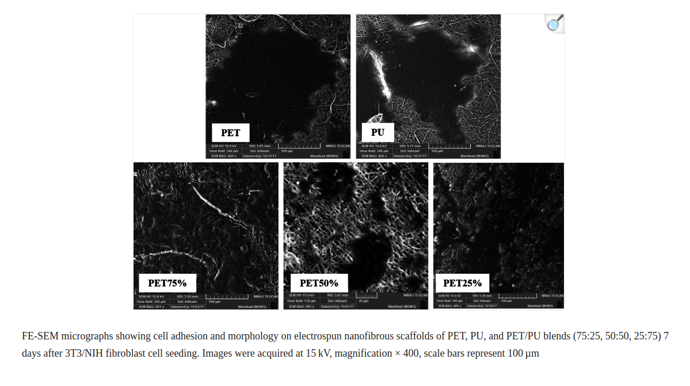
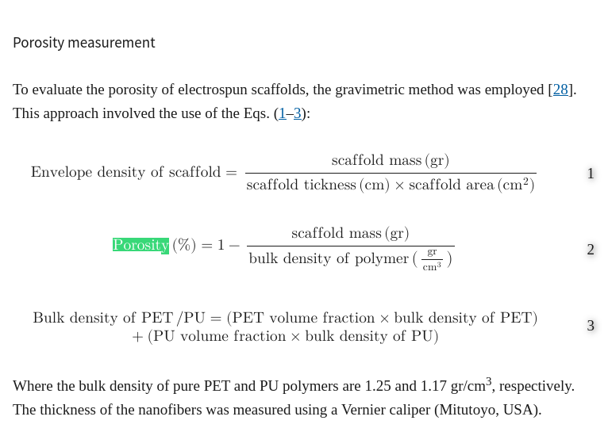
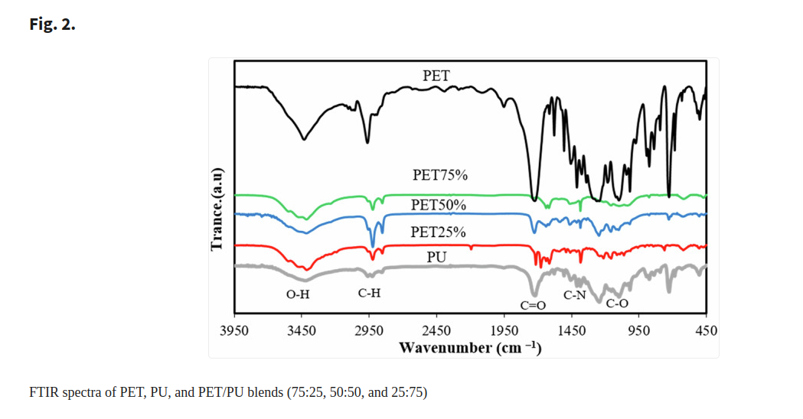
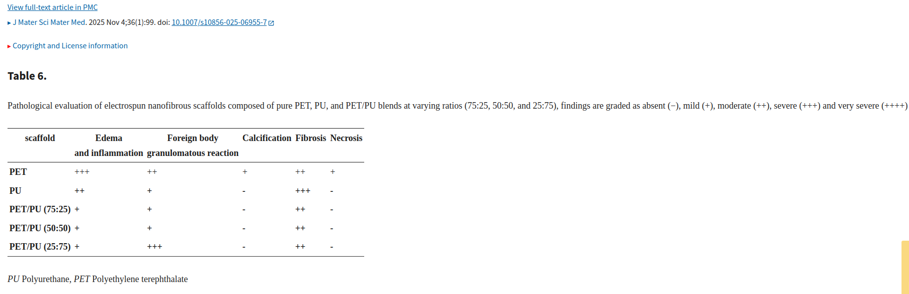
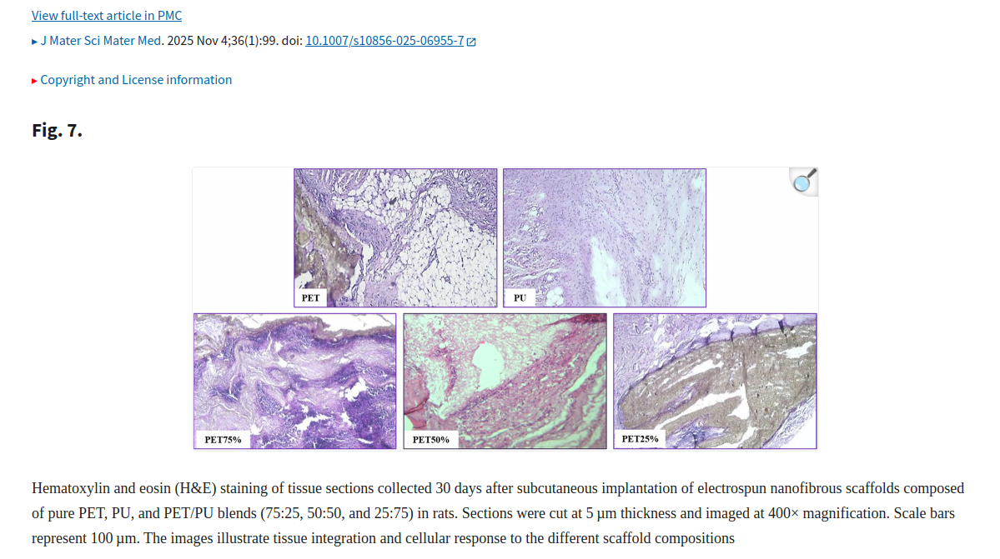

# خلاصه جامع مقاله PET/PU برای آمادگی آزمون

## مشخصات مقاله
- **عنوان:** Development of a novel small diameter vascular graft based on an electrospun blend PET/PU scaffold: from fabrication to structural, mechanical, and in vitro evaluation
- **ترجمه:** توسعه گرافت عروقی با قطر کم بر پایه داربست الکتروریسی‌شده ترکیبی PET/PU؛ از ساخت تا ارزیابی ساختاری، مکانیکی و آزمایشگاهی
- **نویسندگان:** Mohaddese Mohaddesi و همکاران
- **مجله:** Journal of Materials Science: Materials in Medicine
- **سال:** 2025؛ جلد 36؛ مقاله 99
- **DOI:** https://doi.org/10.1007/s10856-025-06955-7
- **متن کامل:** https://pmc.ncbi.nlm.nih.gov/articles/PMC12586214/

---

## ۱. هدف و مسئله پژوهش

هدف مقاله، ساخت داربست لوله‌ای نانوالیافی برای گرافت عروقی با قطر کم (Small-Diameter Vascular Graft; SDVG) است. گرافت‌های مصنوعی در عروق بزرگ عملکرد مناسبی دارند، اما در عروق کوچک با مشکلاتی مانند موارد زیر مواجه‌اند:

1. عدم تطابق کامپلاینس (Compliance mismatch): میزان انبساط و انقباض گرافت با رگ طبیعی یکسان نیست.
2. ترومبوز (Thrombosis): تشکیل لخته خون.
3. هایپرپلازی نئواینتیما (Neointimal hyperplasia): ضخیم شدن لایه داخلی رگ و تنگی مجرا.
4. کلسیفیکاسیون (Calcification): رسوب مواد معدنی در بافت.
5. انسداد و شکست گرافت.

راهکار مقاله ترکیب دو پلیمر PET و PU است تا استحکام PET با انعطاف‌پذیری PU همراه شود. سپس مخلوط‌ها با الکتروریسی به شبکه‌ای نانوالیافی تبدیل می‌شوند که از نظر ساختار تا حدی ماتریکس خارج‌سلولی (ECM) را تقلید می‌کند.

## ۲. مواد اولیه و نسبت‌های پلیمری

### پلیمرهای اصلی

| پلیمر | نام کامل | نقش مورد انتظار |
|---|---|---|
| PET | Polyethylene Terephthalate | استحکام و پایداری مکانیکی بالا؛ اما نسبتاً سفت و کم‌کامپلاینس |
| PU | Polyurethane | انعطاف‌پذیری و الاستیسیته بیشتر؛ اما استحکام و فشار ترکیدن پایین‌تر از PET خالص |

مقاله هر دو پلیمر را دارای تأییدیه FDA معرفی می‌کند؛ این به معنی تأیید FDA برای همین داربست یا تأیید کاربرد بالینی آن نیست.

### آماده‌سازی محلول‌ها

| ماده | حلال | غلظت | شرایط آماده‌سازی |
|---|---|---:|---|
| PET | HFIP | ۵ درصد وزنی (5 wt%) | هم‌زدن ۲۴ ساعت در دمای اتاق |
| PU | THF:DMF با نسبت حجمی ۳:۱ | ۱۸ درصد وزنی (18 wt%) | هم‌زدن ۱۲ ساعت در دمای اتاق |

جرم مولکولی PET برابر ۱۸۰۰۰ گرم بر مول گزارش شده است. PET با کد TG641 استفاده شد.

پس از تهیه محلول‌های خالص، محلول‌ها با هم ترکیب و ۴۵ دقیقه در دمای اتاق هم زده شدند.

### نسبت‌های ترکیب PET:PU

| نام نمونه | نسبت PET:PU | درصد PET | درصد PU |
|---|---:|---:|---:|
| PET خالص | 100:0 | ۱۰۰٪ | صفر |
| PU خالص | 0:100 | صفر | ۱۰۰٪ |
| PET75% | 75:25 | ۷۵٪ | ۲۵٪ |
| PET50% | 50:50 | ۵۰٪ | ۵۰٪ |
| PET25% | 25:75 | ۲۵٪ | ۷۵٪ |

**نکته امتحانی:** PET25% یعنی ۲۵ درصد PET و ۷۵ درصد PU؛ نام‌گذاری نمونه‌ها بر اساس درصد PET است.

### سایر مواد
- HFIP: حلال PET
- THF و DMF: حلال‌های PU
- MTT: معرف آزمون زنده‌مانی
- FBS: سرم جنین گاوی
- DMEM: محیط کشت
- Trypsin-EDTA: جداکردن سلول‌ها
- پنی‌سیلین و استرپتومایسین: آنتی‌بیوتیک محیط کشت
- PBS: بافر فسفات
- DMSO: حل‌کردن کریستال‌های فورمازان در آزمون MTT
- فرمالین: تثبیت نمونه‌های بافتی
- H&E: رنگ‌آمیزی بافت‌شناسی

## ۳. روش ساخت: الکتروریسی (Electrospinning)

در الکتروریسی، محلول پلیمری تحت میدان الکتریکی از نوک سوزن کشیده می‌شود و رشته‌های بسیار ظریف روی جمع‌کننده قرار می‌گیرند. با تجمع الیاف، داربست نانوالیافی متخلخل تشکیل می‌شود.

### مراحل ساخت
1. حل‌کردن PET در HFIP و تهیه محلول ۵ درصد وزنی.
2. حل‌کردن PU در THF/DMF با نسبت ۳:۱ و تهیه محلول ۱۸ درصد وزنی.
3. ترکیب محلول‌ها با نسبت‌های ۷۵:۲۵، ۵۰:۵۰ و ۲۵:۷۵.
4. هم‌زدن ۴۵ دقیقه‌ای برای یکنواخت‌شدن مخلوط.
5. الکتروریسی محلول‌های خالص و ترکیبی و تشکیل داربست لوله‌ای.

### پارامترهای دستگاه طبق متن روش‌ها
- سرنگ ۵ میلی‌لیتری
- سوزن فلزی کند ۱۸G
- ولتاژ اعمالی گزارش‌شده: ۱۸ کیلوولت
- ماندرل استیل چرخان با قطر ۱٫۲ میلی‌متر
- فاصله کاری: ۱۵ سانتی‌متر
- سرعت خطی ماندرل: ۲۰۰۰ میلی‌متر بر دقیقه
- سرعت چرخش: ۳۰۰ دور بر دقیقه
- دمای محیط: ۲۰ تا ۲۵ درجه سانتی‌گراد
- رطوبت نسبی: ۵۰ تا ۶۰ درصد
- نرخ جریان در متن روش: PET برابر ۰٫۳ و PU و مخلوط‌ها برابر ۰٫۵ میلی‌لیتر بر دقیقه

**احتیاط در نقل پارامترها:** جدول ۱ مقاله در برخی مقادیر با متن روش‌ها هم‌خوانی کامل ندارد. به‌ویژه مقادیر ولتاژ و نرخ جریان جدول با متن تفاوت دارند. اعداد بالا از متن روش‌ها نقل شده‌اند؛ در صورت سؤال درباره جدول، اختلاف را ذکر کن و عدد را به بخش منبع آن نسبت بده.

## ۴. آزمون‌های ساختاری و شیمیایی

### ۴.۱. FE-SEM

**هدف:** مشاهده مورفولوژی، پیوستگی الیاف، قطر الیاف، تخلخل و نحوه قرارگیری سلول‌ها روی داربست.

- نمونه‌ها با لایه نازکی از طلا پوشش داده شدند.
- قطر ۱۰۰ الیاف تصادفی با ImageJ اندازه‌گیری شد.
- شبکه الیافی صاف، متصل و متخلخل بود و bead قابل‌توجهی مشاهده نشد.

### ۴.۲. قطر الیاف

| نمونه | قطر الیاف (nm)، میانگین ± انحراف معیار |
|---|---:|
| PET | 403 ± 44 |
| PU | 470 ± 95 |
| PET75% | 457 ± 89 |
| PET50% | 369 ± 91 |
| PET25% | 343 ± 94 |

- بیشترین قطر میانگین: PU خالص.
- کمترین قطر میانگین: PET25% (۲۵٪ PET و ۷۵٪ PU).
- قطر الیاف PET25% و PET50% نسبت به نمونه‌های خالص به‌طور معنی‌داری کمتر گزارش شد.

### ۴.۳. تخلخل(Porosity)

تخلخل با روش وزنی اندازه‌گیری شد. چگالی PET برابر ۱٫۲۵ و چگالی PU برابر ۱٫۱۷ گرم بر سانتی‌متر مکعب در محاسبات استفاده شد.

| نمونه | تخلخل (%) |
|---|---:|
| PET | ۷۴ ± ۱٫۳۷ |
| PU | ۶۳ ± ۰٫۴۶ |
| PET75% | ۵۶٫۵ ± ۲٫۳ |
| PET50% | ۶۹٫۵ ± ۴٫۵ |
| PET25% | ۵۸٫۶ ± ۵٫۱۲ |

بیشترین تخلخل مربوط به PET خالص و کمترین آن مربوط به PET75% است. تخلخل برای نفوذ سلول، انتقال مواد غذایی و تبادل مواد اهمیت دارد.

### ۴.۴. FTIR

**هدف:** شناسایی گروه‌های عاملی و بررسی حضور ویژگی‌های شیمیایی دو پلیمر در ترکیب.

- بازه عدد موج: ۴۰۰ تا ۴۰۰۰ cm⁻¹
- وضوح: ۱ cm⁻¹
- نمونه‌سازی با قرص KBr

نتایج:
- ناحیه حدود ۳۰۰۰ cm⁻¹: ارتعاش کششی C–H.
- PET: پیک ۱۷۱۰ تا ۱۷۴۰ cm⁻¹ مربوط به کربونیل استر C=O.
- PET: پیک‌های ۱۵۰۰ تا ۱۶۰۰ و ۷۰۰ تا ۹۰۰ cm⁻¹ با حلقه‌های آروماتیک مرتبط‌اند.
- PU: باند پهن ۳۳۰۰ تا ۳۵۰۰ cm⁻¹ به گروه‌های O–H باقی‌مانده و پیوندهای هیدروژنی نسبت داده شده است.
- با افزایش سهم PET، شدت باند پهن O–H کاهش می‌یابد.

### ۴.۵. DSC
**هدف:** اندازه‌گیری دمای انتقال شیشه‌ای (Tg) و دمای ذوب (Tm) و بررسی رفتار حرارتی.

- دستگاه: Netzsch DSC-200 F3
- جرم نمونه: ۱ میلی‌گرم
- بازه دمایی: ۲۰ تا ۵۰۰ درجه سانتی‌گراد
- نرخ گرمایش: ۱۰ درجه سانتی‌گراد بر دقیقه

| نمونه | Tg (°C) | Tm (°C) |
|---|---:|---:|
| PET | ۷۴٫۹ | ۲۶۰٫۱ |
| PU | ۴۷٫۱ | ۸۴٫۹ |
| PET75% | ۶۵٫۰۵ | ۲۵۵٫۲۲ |
| PET50% | ۵۹٫۰۵ | ۲۴۶٫۷ |
| PET25% | ۵۷٫۵۴ | ۲۵۱٫۳ |

PET خالص بیشترین Tg و Tm و PU خالص کمترین مقادیر را دارد. مقادیر مخلوط‌ها بین دو پلیمر خالص قرار گرفته‌اند. کاهش Tg با افزایش PU با اثر نرم‌کنندگی PU و افزایش انعطاف‌پذیری سازگار است.

## ۵. آزمون‌های مکانیکی و بیومکانیکی

### ۵.۱. آزمون کشش تک‌محوری (Uniaxial Tensile Test)
**هدف:** بررسی مقاومت در برابر کشش و استخراج منحنی تنش–کرنش.

- دستگاه: SANTAM Engineering Design
- ظرفیت بار: ۵۰ نیوتن
- سرعت جابه‌جایی: ۵ میلی‌متر بر دقیقه
- تعداد نمونه: پنج نمونه برای هر شرایط طبق متن روش‌ها
- مدول یانگ از بیشترین شیب بخش خطی منحنی در بازه کرنش صفر تا ۱۵٪ محاسبه شد.

پارامترها: نیرو، تنش، کرنش، تنش کششی نهایی (UTS)، کرنش شکست و مدول یانگ.

| نمونه | نیرو (N) | تنش (MPa) | کرنش گزارش‌شده (%) | مدول یانگ (MPa) |
|---|---:|---:|---:|---:|
| PET | ۱۰٫۰۳ ± ۰٫۷۵ | ۴٫۰۴ ± ۰٫۴۴۵ | ۱۰۰ ± ۸ | ۱۸٫۰۲ ± ۱٫۸ |
| PU | ۷٫۲۶ ± ۰٫۹۶ | ۳٫۱۹ ± ۰٫۵۴ | ۳۲۱ ± ۷۱ | ۱٫۲ ± ۰٫۳۹ |
| PET75% | ۷٫۱۱ ± ۱٫۵۲ | ۲٫۶۶ ± ۰٫۳۹ | ۳۸۸ ± ۵٫۲۴ | ۱۹٫۳ ± ۲٫۰۴ |
| PET50% | ۴۰٫۸۸ ± ۹٫۲۱ | ۱۹٫۰۵ ± ۳٫۲۰ | ۳۳۹ ± ۸۵ | ۴۱٫۴ ± ۳٫۳۱ |
| PET25% | ۱۸٫۶۰ ± ۳٫۰۸ | ۹٫۲۴ ± ۰٫۶۱ | ۴۲۱ ± ۵۱٫۳۵ | ۳٫۱۸ ± ۰٫۰۹ |

**نکته واحد:** در جدول اصلی، واحد ستون Strain به‌صورت MPa درج شده که از نظر فیزیکی واحد کرنش نیست. مقادیر در اینجا به‌عنوان درصد کرنش نمایش داده شده‌اند؛ هنگام نقل جدول اصلی، این ایراد نگارشی را در نظر داشته باش.

**نتیجه:** PET50% بیشترین نیرو، تنش و مدول یانگ را نشان داد. PET25% کرنش بالاتر و مدول پایین‌تری داشت و از نظر انعطاف‌پذیری به PU نزدیک‌تر بود.

### ۵.۲. فشار ترکیدن (Burst Pressure)
**هدف:** تعیین بیشترین فشار داخلی قابل تحمل پیش از پارگی داربست لوله‌ای.

| نمونه | فشار ترکیدن (mmHg) |
|---|---:|
| PET | ۲۹۳۲ ± ۳۷۳ |
| PU | ۱۱۵۶ ± ۱۴۹ |
| PET75% | ۲۶۴۸ ± ۲۲۷ |
| PET50% | ۳۰۸۳ ± ۲۰۲ |
| PET25% | ۲۰۴۰ ± ۱۵۷ |

بیشترین فشار ترکیدن مربوط به PET50% و کمترین مقدار مربوط به PU خالص است. فشار ترکیدن PET50% با PET خالص قابل مقایسه است.

### ۵.۳. کامپلاینس (Compliance)
**هدف:** سنجش توانایی انبساط و انقباض الاستیک گرافت در پاسخ به تغییر فشار، مشابه ضربان رگ.

- آزمون بر اساس توصیه‌های ISO 7198:2016 انجام شد.
- فشار دیاستولی: ۸۰ mmHg
- فشار سیستولی: ۱۲۰ mmHg
- محیط اعمال فشار: PBS
- تغییر قطر خارجی با دوربین ثبت و با ImageJ تحلیل شد.

| نمونه | کامپلاینس (%/100 mmHg) |
|---|---:|
| PET | ۱٫۹۳۰ ± ۰٫۱۰۷ |
| PU | ۹٫۱ ± ۰٫۳ |
| PET75% | ۳٫۸۲ ± ۰٫۳۲۵ |
| PET50% | ۲٫۹۵ ± ۰٫۳۵ |
| PET25% | ۵٫۶ ± ۰٫۳۱ |

PU خالص بیشترین و PET خالص کمترین کامپلاینس را داشتند. در میان مخلوط‌ها، PET25% بیشترین کامپلاینس را نشان داد. مقاله محدوده تقریبی ۳ تا ۶ %/mmHg را برای کامپلاینس عروق کوچک طبیعی مطرح می‌کند؛ واحد جدول مقاله به‌شکل %/100 mmHg نوشته شده است، بنابراین در نقل واحد باید به همین شیوه مقاله توجه کرد.

**جمع‌بندی مکانیکی:** PET50% برای استحکام و فشار ترکیدن برجسته است؛ PET25% از نظر انعطاف‌پذیری و کامپلاینس مناسب‌تر است. بهترین ترکیب به معیار مورد نظر بستگی دارد.

## ۶. آزمون‌های زیستی (In vitro)

### ۶.۱. رده سلولی و محیط کشت
در روش‌ها از رده فیبروبلاستی 3T3/NIH، در پاساژ پنجم، استفاده شده است.

- محیط: DMEM با گلوکز بالا
- FBS: ده درصد
- پنی‌سیلین/استرپتومایسین: یک درصد
- دما: ۳۷ درجه سانتی‌گراد
- محیط کشت هر سه روز تعویض شد.
- قطعات داربست برای آزمون زنده‌مانی: ۱ × ۱ سانتی‌متر مربع
- استریل‌سازی داربست: پلاسما

**دقت علمی:** رده 3T3/NIH در روش‌ها به‌عنوان فیبروبلاست معرفی شده است؛ آن را نباید سلول اندوتلیال یا MSC نامید. همچنین این آزمون، آزمایش انسانی یا کارآزمایی بالینی نیست.

### ۶.۲. آزمون MTT و بررسی زنده‌مانی سلول‌ها (Cell Viability)

**هدف آزمون:** بررسی این‌که آیا داربست PET/PU برای سلول‌ها سمی است یا خیر و آیا سلول‌ها در تماس با سطح داربست می‌توانند زنده بمانند و فعالیت متابولیکی خود را حفظ کنند. آزمون MTT یک روش رنگ‌سنجی غیرمستقیم برای تخمین فعالیت متابولیکی سلول‌های زنده است؛ بنابراین جذب نوری بالاتر معمولاً نشان‌دهنده فعالیت متابولیکی/تعداد سلول بیشتر است، اما شمارش مستقیم سلول‌های زنده نیست.

#### الف) آماده‌سازی پیش از آزمون

1. داربست‌های الکتروریسی‌شده به قطعات مربع با ابعاد **۱ × ۱ سانتی‌متر مربع** بریده شدند.
2. قطعات با روش **پلاسما** استریل شدند تا آلودگی میکروبی وارد کشت سلولی نشود.
3. رده سلولی مورد استفاده در بخش روش‌ها **3T3/NIH fibroblast** در پاساژ پنجم (P5) بود. این رده در مقاله به‌عنوان فیبروبلاست معرفی شده است؛ سلول اندوتلیال یا سلول انسانی اولیه نیست.
4. سلول‌ها در محیط **DMEM با گلوکز بالا** کشت داده شدند که با **۱۰٪ FBS** و **۱٪ پنی‌سیلین/استرپتومایسین** مکمل شده بود.
5. سلول‌ها در انکوباتور مرطوب دارای CO₂ و در دمای **۳۷ درجه سانتی‌گراد** نگهداری شدند تا به حالت رشد متراکم (Confluence) برسند. محیط کشت هر **سه روز یک‌بار** تعویض می‌شد.

#### ب) کاشت سلول روی داربست

- داربست‌های استریل‌شده در چاهک‌های پلیت **۹۶ خانه‌ای (96-well plate)** قرار داده شدند.
- سوسپانسیون سلولی با تراکم **۴۰٬۰۰۰ سلول در میلی‌لیتر** به چاهک‌ها اضافه شد.
- پس از اضافه‌کردن سلول‌ها، حدود **۲۴ تا ۴۸ ساعت** زمان داده شد تا سلول‌ها به سطح داربست متصل شوند و رشد اولیه را آغاز کنند.
- گروه‌های بررسی‌شده شامل PET خالص، PU خالص و سه ترکیب PET/PU با نسبت‌های **۷۵:۲۵، ۵۰:۵۰ و ۲۵:۷۵** بودند. گروه کنترل نیز مبنای مقایسه جذب نوری قرار گرفت.

#### ج) انجام واکنش MTT

1. آزمون در سه زمان **روز سوم، روز پنجم و روز هفتم** انجام شد.
2. در هر زمان، **۲۰ میکرولیتر محلول MTT با غلظت ۵ میلی‌گرم بر میلی‌لیتر** به هر چاهک اضافه شد.
3. پلیت به مدت **۴ ساعت** انکوبه شد تا سلول‌های دارای فعالیت متابولیکی، نمک تترازولیوم MTT را به محصول رنگی نامحلول به نام **فورمازان (Formazan)** تبدیل کنند.
4. پس از پایان انکوباسیون، محیط کشت از چاهک‌ها خارج/آسپیره شد.
5. به هر چاهک **۱۰۰ میکرولیتر DMSO** اضافه شد تا کریستال‌های فورمازان حل شوند و محلول رنگی یکنواخت ایجاد شود.
6. جذب نوری (Absorbance) در طول موج **۵۷۰ نانومتر** با دستگاه میکروپلیت‌ریدر **BioTek ELx 808** اندازه‌گیری شد.

**مبنای شیمیایی آزمون:** MTT زردرنگ است. سلول‌هایی که فعالیت متابولیکی دارند، آن را به فورمازان بنفش‌رنگ تبدیل می‌کنند. هرچه مقدار فورمازان حل‌شده و جذب نوری بیشتر باشد، معمولاً فعالیت متابولیکی سلول‌های موجود در نمونه بیشتر است. سلول‌های مرده یا فاقد فعالیت متابولیکی، این تبدیل را به میزان بسیار کمتری انجام می‌دهند.

#### د) فرمول محاسبه درصد زنده‌مانی نسبی

مقاله درصد زنده‌مانی را نسبت جذب نوری نمونه به میانگین جذب نوری گروه کنترل محاسبه کرده است:

\[
	ext{Cell viability (\%)} = rac{	ext{Mean absorbance of sample}}{	ext{Mean absorbance of control}} 	imes 100
\]

- **Mean absorbance of sample:** میانگین جذب نوری چاهک‌های حاوی سلول و داربست.
- **Mean absorbance of control:** میانگین جذب نوری گروه کنترل.
- کنترل در این محاسبه برابر **۱۰۰٪** در نظر گرفته می‌شود.

**مثال آموزشی (نه داده واقعی مقاله):** اگر جذب نوری نمونه ۰٫۲۰ و جذب نوری کنترل ۰٫۱۰ باشد، زنده‌مانی نسبی برابر است با ۲۰۰٪. این عدد به معنی زنده‌بودن ۲۰۰ درصد سلول‌ها نیست؛ یعنی سیگنال متابولیکی نمونه دو برابر کنترل بوده است.

#### هـ) نتایج زنده‌مانی سلولی در روزهای ۳، ۵ و ۷

طبق متن نتایج مقاله، تمام گروه‌های داربستی در هر سه زمان از زنده‌مانی سلول پشتیبانی کردند و نشانه‌ای از سمیت سلولی (Cytotoxicity) مشاهده نشد. درصد زنده‌مانی نسبی در طول زمان افزایش یافت و در روز هفتم در همه گروه‌های داربستی از **۲۰۰٪** فراتر رفت.

نمودار شکل ۵ مقاله، مقادیر را به‌صورت نمودار میله‌ای و بدون جدول عددی دقیق ارائه کرده است. بنابراین اعداد زیر **تخمین تقریبی از ارتفاع میله‌های نمودار** هستند، نه مقادیر عددی دقیق گزارش‌شده در جدول:

| نمونه | روز ۳، تقریبی | روز ۵، تقریبی | روز ۷، تقریبی |
|---|---:|---:|---:|
| PET خالص | حدود ۱۲۵٪ | حدود ۱۵۳٪ | حدود ۱۹۵٪ |
| PET/PU (75:25)؛ PET75% | حدود ۱۱۵٪ | حدود ۱۹۴٪ | حدود ۲۰۲٪ |
| PET/PU (50:50)؛ PET50% | حدود ۱۵۷٪ | حدود ۲۱۲٪ | حدود ۲۴۸٪ |
| PET/PU (25:75)؛ PET25% | حدود ۱۵۶٪ | حدود ۲۰۴٪ | حدود ۲۶۵٪ |
| PU خالص | حدود ۱۵۵٪ | حدود ۲۰۷٪ | حدود ۲۴۵٪ |
| کنترل | ۱۰۰٪ | ۱۰۰٪ | ۱۰۰٪ |

**توجه به اختلاف در گزارش مقاله:** متن بخش نتایج مقاله، ترکیب PET/PU با نسبت **۷۵:۲۵** را دارای بیشترین زنده‌مانی معرفی می‌کند؛ اما در نمودار شکل ۵، بلندترین میله روز هفتم ظاهراً مربوط به گروه **PET/PU (25:75)** است. چون مقاله جدول عددی خام یا مقادیر دقیق هر میله را ارائه نکرده، این اختلاف را باید به‌عنوان ناسازگاری بین متن و نمودار ذکر کرد و نباید یکی از آن‌ها را بدون توضیح قطعی دانست.

#### و) تفسیر علمی نتیجه MTT

- افزایش سیگنال MTT از روز ۳ به روز ۷ با افزایش فعالیت متابولیکی و رشد/تکثیر سلول‌ها روی داربست سازگار است.
- بالاتر بودن سیگنال نسبت به کنترل نشان می‌دهد داربست‌ها در شرایط آزمون مانع فعالیت متابولیکی سلول‌ها نشده‌اند و از رشد سلولی پشتیبانی کرده‌اند.
- عبور مقدار نسبی از ۱۰۰٪ به معنی «بیش از صددرصد زنده‌بودن» نیست؛ درصدها نسبت به کنترل نرمال شده‌اند.
- MTT به‌تنهایی تعداد دقیق سلول‌ها، درصد مرگ سلولی یا سازگاری خونی را تعیین نمی‌کند. برای تأیید بهتر باید آن را همراه با آزمون‌های دیگر، مانند مشاهده مورفولوژی و چسبندگی سلولی، تفسیر کرد.
- این آزمون روی فیبروبلاست 3T3/NIH انجام شده است؛ بنابراین نتیجه آن به‌تنهایی اثبات نمی‌کند که سطح داربست برای سلول‌های اندوتلیال مناسب است یا لایه اندوتلیالی عملکردی تشکیل می‌دهد.

**نتیجه کلی MTT:** هر پنج نوع داربست (PET، PU و سه ترکیب آن‌ها) در بازه هفت‌روزه اثر سمی آشکاری بر سلول‌های آزمایش‌شده نشان ندادند و سیگنال زنده‌مانی/فعالیت متابولیکی در طول زمان افزایش یافت. اختلاف متن مقاله و نمودار شکل ۵ درباره نمونه دارای بیشترین مقدار باید در پاسخ امتحانی با احتیاط بیان شود.

### ۶.۳. چسبندگی سلولی (Cell Adhesion)
- رده سلولی: 3T3/NIH
- تعداد سلول: ۱۰٬۰۰۰ سلول روی هر داربست
- پلیت: ۴۸ خانه
- انکوباسیون اولیه: ۳۰ دقیقه در ۳۷ درجه در شیکر
- زمان ارزیابی: روزهای ۳، ۵ و ۷
- تثبیت: فرمالدهید ۴٪
- آب‌گیری: اتانول ۶۰، ۷۰، ۸۰، ۹۰ و ۱۰۰ درصد
- مشاهده: FE-SEM

نتایج:
- سلول‌ها روی تمام نمونه‌ها اتصال و گسترش داشتند.
- PET75% و PET50% چسبندگی و تکثیر گسترده‌تری نشان دادند.
- در PET50% سلول‌ها کشیده‌تر و گسترده‌تر بودند.
- در PET25% و PU خالص سلول‌ها پراکنده‌تر بودند.
- نفوذ سلول به لایه‌های عمیق‌تر شبکه الیافی نیز مشاهده شد.

## ۷. تست حیوانی (In vivo) و ارزیابی واکنش بافتی قبل و بعد از کاشت

**هدف:** بررسی واکنش بدن به داربست پس از قرارگرفتن در بافت زنده؛ به‌ویژه التهاب، ادم، تشکیل بافت گرانولاسیون، واکنش جسم خارجی، فیبروز، کلسیفیکاسیون و نکروز. این مرحله ارزیابی زیست‌سازگاری درون‌تنی (In vivo biocompatibility) است.

### ۷.۱. حیوانات و شرایط نگهداری پیش از جراحی

- گونه: موش صحرایی (Rat) از نژاد **Sprague-Dawley**
- جنس: نر
- سن: **۸ هفته**
- وزن تقریبی: **۲۵۰ گرم**
- تعداد: **۴ موش در هر گروه**
- دمای اتاق: **۲۲ ± ۲ درجه سانتی‌گراد**
- رطوبت نسبی: **۵۲ ± ۵ درصد**
- چرخه روشنایی/تاریکی: **۱۲ ساعت روشنایی و ۱۲ ساعت تاریکی**
- تغذیه: غذای استاندارد آزمایشگاهی

تمام مراحل حیوانی با تأیید کمیته اخلاق پژوهشی دانشگاه علوم پزشکی مشهد انجام شد. شماره تأیید اخلاق گزارش‌شده در مقاله: **IR.MUMS.MEDICAL.REC.1399.019**.

### ۷.۲. آماده‌سازی حیوان و داربست پیش از کاشت

1. حیوانات برای انجام جراحی تحت بیهوشی عمومی قرار گرفتند.
2. داروهای بیهوشی به‌صورت داخل‌صفاقی (i.p.) تزریق شدند:
   - کتامین: **۷۰ mg/kg**
   - زایلازین: **۱۰ mg/kg**
3. محل جراحی در پای راست تراشیده شد.
4. پوست محل جراحی با **اتانول ۷۰٪** و **کلرهگزیدین ۲٪** ضدعفونی شد.
5. برای جلوگیری از خشک‌شدن قرنیه، پماد چشمی ویتامین A استفاده شد.
6. اصول استریل و آسپتیک در تمام مراحل جراحی رعایت شد.

### ۷.۳. روش کاشت داربست

- در پوست پای راست حیوان، **دو برش به طول ۱۰ میلی‌متر** ایجاد شد.
- قطعات داربست در فضای **زیرپوستی (Subcutaneous)** قرار داده شدند؛ یعنی داربست در زیر پوست کاشته شد و به داخل شریان یا ورید متصل نشد.
- محل برش‌ها با نخ نایلون **۵-۰** بخیه شد.
- برای کنترل درد پس از جراحی، **ملوکسیکام ۰٫۵ mg/kg** به‌صورت داخل‌صفاقی تجویز شد.
- برای پیشگیری از عفونت، **تتراسایکلین ۵ mg/kg** به‌صورت داخل‌صفاقی تجویز شد.

**نکته مهم درباره محل کاشت:** هدف این مدل، سنجش پاسخ بافت میزبان به ماده کاشته‌شده است. این مدل، آزمون بازبودن مجرای گرافت، مقاومت در برابر جریان خون، تشکیل لخته در داخل گرافت یا عملکرد واقعی آن به‌عنوان جایگزین شریان نیست.

### ۷.۴. دوره پس از کاشت و پیگیری

- داربست‌ها به مدت **۳۰ روز** در زیر پوست باقی ماندند.
- در این مدت پاسخ بدن و واکنش ایمنی/بافتی به حضور داربست بررسی شد.
- پس از ۳۰ روز، حیوانات طبق دستورالعمل اخلاقی با استنشاق **CO₂** یوتانایز شدند.
- داربست کاشته‌شده به همراه بافت اطراف آن خارج شد.
- نمونه‌ها بلافاصله در **PBS** قرار گرفتند تا از خشک‌شدن بافت جلوگیری شود.

### ۷.۵. آماده‌سازی نمونه بافتی پس از خارج‌کردن

1. نمونه داربست به همراه بافت اطراف در فرمالین بافر خنثی **۱۰٪** قرار گرفت و حداقل **۴۸ ساعت** تثبیت شد.
2. برش‌های سریالی با ضخامت **۵ میکرومتر** تهیه شدند.
3. برش‌گیری از ناحیه‌ای آغاز شد که حدود **۱ میلی‌متر داخل داربست** قرار داشت تا ارزیابی ناحیه کاشت به‌صورت یکنواخت انجام شود.
4. برش‌ها با رنگ‌آمیزی **Hematoxylin and Eosin (H&E)** بررسی شدند.
5. تصاویر بافت‌شناسی با بزرگ‌نمایی **۴۰۰ برابر** تهیه شدند.

### ۷.۶. شاخص‌های بررسی‌شده در بافت پس از کاشت

مقاله هفت شاخص ترمیم و واکنش بافتی را ارزیابی کرده است:

| شاخص | معنی و اهمیت |
|---|---|
| Edema | ادم یا تجمع مایع در بافت اطراف داربست؛ نشانه‌ای از پاسخ بافتی/التهابی |
| Inflammation | حضور و تجمع سلول‌های التهابی در اطراف ماده کاشته‌شده |
| Calcification | رسوب مواد معدنی/کلسیم در بافت یا اطراف داربست |
| Foreign body granulomatous reaction | واکنش گرانولوماتوز جسم خارجی؛ پاسخ مزمن به ماده‌ای که بدن آن را جسم خارجی تشخیص می‌دهد |
| Granulation tissue formation | تشکیل بافت گرانولاسیون در فرایند ترمیم زخم |
| Fibroblastic change / Fibrosis | فعالیت فیبروبلاست‌ها و تشکیل بافت فیبروزی یا اسکار |
| Necrosis | مرگ بافتی در ناحیه اطراف داربست |

شدت هر شاخص به این صورت درجه‌بندی شد:

| علامت | شدت |
|---|---|
| − | مشاهده نشد (Absent) |
| + | خفیف (Mild) |
| ++ | متوسط (Moderate) |
| +++ | شدید (Severe) |
| ++++ | بسیار شدید (Very severe) |

### ۷.۷. نتایج پس از ۳۰ روز

طبق توصیف نتایج بافت‌شناسی مقاله:

- تمام گروه‌ها درجاتی از ادم و نفوذ سلول‌های التهابی را نشان دادند؛ بنابراین پاسخ بافتی کاملاً صفر نبود.
- داربست‌های ترکیبی PET/PU در مجموع پاسخ التهابی کمتری نسبت به پلیمرهای خالص نشان دادند.
- واکنش گرانولوماتوز جسم خارجی در گروه PET/PU با نسبت **۷۵:۲۵** خفیف گزارش شد و در گروه **۲۵:۷۵** در توصیف متنی مقاله وجود نداشت.
- ادم و فیبروز خفیف در گروه PET/PU با نسبت ۷۵:۲۵ گزارش شد.
- در گروه PET/PU با نسبت ۲۵:۷۵، ادم و فیبروز خفیف و واکنش گرانولوماتوز متوسط در متن نتایج توصیف شده است.
- کلسیفیکاسیون فقط در PET خالص گزارش شد.
- نکروز خفیف فقط در PET خالص مشاهده شد و در بافت اطراف سایر داربست‌ها تغییر نکروتیک گزارش نشد.
- مقاله ارتباطی بین افزایش سهم PU در ترکیب و افزایش تشکیل بافت فیبروزی مطرح می‌کند.

**توجه به ناسازگاری در گزارش مقاله:** در متن نتایج، بعضی توصیف‌های واکنش گرانولوماتوز و فیبروز با جدول درجه‌بندی آسیب‌شناسی کاملاً هم‌راستا نیستند. همچنین در یک بخش از متن نتایج به چهار نوع داربست اشاره شده، در حالی که گروه‌های مطالعه شامل PET، PU و سه ترکیب PET/PU هستند. بنابراین در پاسخ دقیق، بهتر است همواره مشخص شود که یک یافته از «توصیف متنی» گرفته شده یا از «جدول آسیب‌شناسی»؛ بدون مراجعه مستقیم به داده خام نمی‌توان این اختلاف را برطرف کرد.

### ۷.۸. قبل و بعد از تست حیوانی؛ جمع‌بندی روند آزمایش

| مرحله | وضعیت قبل/حین کاشت | وضعیت پس از ۳۰ روز |
|---|---|---|
| حیوان | موش نر Sprague-Dawley، ۸ هفته، حدود ۲۵۰ گرم | یوتانایز طبق پروتکل اخلاقی |
| محل نمونه | پوست پای راست آماده و ضدعفونی شد | داربست و بافت اطراف از محل زیرپوستی خارج شد |
| داربست | قطعات داربست در فضای زیرپوستی قرار گرفتند | نمونه برای بررسی بافت‌شناسی تثبیت شد |
| پاسخ بدن | آغاز پاسخ میزبان به ماده کاشته‌شده | ادم، التهاب، گرانولوم، فیبروز، کلسیفیکاسیون و نکروز بررسی شدند |
| بررسی بافت | هنوز ارزیابی نهایی انجام نشده بود | برش ۵ میکرومتری و رنگ‌آمیزی H&E انجام شد |
| هدف نتیجه‌گیری | ارزیابی تحمل اولیه ماده در بدن | ارزیابی زیست‌سازگاری بافتی پس از ۳۰ روز |

**نتیجه تست حیوانی:** داربست‌های ترکیبی PET/PU در مقایسه با پلیمرهای خالص عموماً واکنش التهابی کمتری نشان دادند؛ با این حال برخی واکنش‌های بافتی مانند ادم، التهاب، فیبروز یا گرانولوم در بعضی گروه‌ها مشاهده شد. این یافته‌ها فقط درباره سازگاری بافتی در مدل کاشت زیرپوستی و بازه ۳۰ روزه هستند.

**محدودیت بسیار مهم:** این آزمایش اثبات‌کننده رگ‌زایی (Angiogenesis)، تشکیل رگ عملکردی، بازماندن گرافت در جریان خون یا موفقیت بالینی نیست. برای اثبات عملکرد واقعی گرافت عروقی باید آن را در مدل عروقی مناسب به جریان خون متصل کرد و شاخص‌هایی مانند بازماندن مجرا، ترومبوز، اندوتلیالیزاسیون و پاسخ همودینامیک را ارزیابی کرد.

## ۸. تحلیل آماری
- نرم‌افزار: SPSS نسخه 22
- گزارش داده‌ها: میانگین ± انحراف معیار
- آزمون اصلی: ANOVA
- آزمون پس‌آزمون: Tukey
- سطح معنی‌داری: p < 0.05

چند مقدار گزارش‌شده:
- قطر الیاف PET25% و PET50% در مقایسه با نمونه‌های خالص: p < 0.0001
- تفاوت تخلخل PET75% و PET50%: p = 0.0047
- تفاوت فشار ترکیدن PET50% و PET25%: p = 0.0018
- تفاوت کامپلاینس PET25% با PET75%: p = 0.0116
- تفاوت کامپلاینس PET25% با PET50%: p = 0.0007

## ۹. جمع‌بندی نتایج و بهترین ترکیب

| معیار | نمونه برجسته | نتیجه |
|---|---|---|
| کمترین قطر الیاف | PET25% | ۳۴۳ نانومتر |
| بیشترین تخلخل | PET خالص | حدود ۷۴٪ |
| بیشترین تنش کششی | PET50% | ۱۹٫۰۵ ± ۳٫۲۰ MPa |
| بیشترین مدول یانگ | PET50% | ۴۱٫۴ ± ۳٫۳۱ MPa |
| بیشترین فشار ترکیدن | PET50% | ۳۰۸۳ ± ۲۰۲ mmHg |
| بیشترین کامپلاینس میان مخلوط‌ها | PET25% | ۵٫۶ ± ۰٫۳۱ |
| بیشترین زنده‌مانی طبق متن نتایج | PET75% | در آزمون MTT |
| چسبندگی و گسترش سلولی مطلوب | PET75% و PET50% | اتصال و گسترش بیشتر |

### مقایسه دو ترکیب مهم

**PET50% (۵۰٪ PET و ۵۰٪ PU):**
- بیشترین استحکام کششی، مدول یانگ و فشار ترکیدن
- چسبندگی سلولی مطلوب
- توازن بین استحکام PET و انعطاف PU

**PET25% (۲۵٪ PET و ۷۵٪ PU):**
- کمترین قطر الیاف
- کامپلاینس بیشتر در میان مخلوط‌ها
- کرنش بیشتر و انعطاف‌پذیری بالاتر
- فشار ترکیدن کمتر از PET50%

پس انتخاب بهترین نمونه به کاربرد و معیار مورد نظر بستگی دارد.

## ۱۰. تست حیوانی و انسانی

| نوع مطالعه | وضعیت |
|---|---|
| تست سلولی (In vitro) | انجام شده؛ MTT و چسبندگی با 3T3/NIH |
| تست حیوانی (In vivo) | انجام شده؛ کاشت زیرپوستی در موش صحرایی |
| تست انسانی | گزارش نشده |
| کارآزمایی بالینی (Clinical trial) | گزارش نشده |
| کاشت گرافت در شریان و ارزیابی عملکرد در جریان خون | در این مقاله گزارش نشده |

تست سلولی در محیط آزمایشگاه معادل تست انسانی نیست. کاشت زیرپوستی در موش نیز با اتصال گرافت به شریان و بررسی عملکرد آن در خون تفاوت دارد.

## ۱۱. محدودیت‌ها و نکات انتقادی

1. ارزیابی حیوانی فقط کاشت زیرپوستی با پیگیری ۳۰ روزه بوده است؛ عملکرد بلندمدت گرافت در شریان مشخص نشده است.
2. مطالعه انسانی یا کارآزمایی بالینی انجام نشده است.
3. آزمون‌های سلولی با رده فیبروبلاستی 3T3/NIH انجام شده‌اند و به‌تنهایی عملکرد اندوتلیال یا تشکیل لایه اندوتلیالی را اثبات نمی‌کنند. در چکیده مقاله عبارت human cell آمده، اما روش‌ها و بخش چسبندگی، 3T3/NIH fibroblast را ذکر می‌کنند؛ بنابراین برای شرح روش آزمایش باید همان رده سلولی گزارش‌شده در روش‌ها را مبنا قرار داد.
4. آزمون‌های مستقیم هموسازگاری مانند ارزیابی کامل همولیز، فعال‌سازی پلاکت و ترومبوژنیسیته در روش‌های اصلی مقاله گزارش نشده‌اند.
5. میان برخی مقادیر جدول پارامترهای الکتروریسی و متن روش‌ها اختلاف وجود دارد.
6. بهترین ترکیب برای استحکام الزاماً بهترین ترکیب برای کامپلاینس نیست.
7. نتایج کاشت زیرپوستی به‌تنهایی اثبات‌کننده عملکرد گرافت در محیط پرفشار و در تماس مستقیم با خون نیست.

## ۱۲. نکات بایدی امتحان

1. هدف: ساخت گرافت عروقی با قطر کم.
2. پلیمرها: PET و PU.
3. نقش PET: استحکام و پایداری.
4. نقش PU: انعطاف‌پذیری و کامپلاینس.
5. روش ساخت: الکتروریسی.
6. حلال PET: HFIP؛ غلظت ۵ wt%.
7. حلال PU: THF/DMF با نسبت ۳:۱؛ غلظت ۱۸ wt%.
8. نسبت‌های ترکیبی PET:PU: برابر ۷۵:۲۵، ۵۰:۵۰ و ۲۵:۷۵.
9. آزمون‌های ساختاری: FE-SEM و تخلخل.
10. آزمون‌های شیمیایی/حرارتی: FTIR و DSC.
11. آزمون‌های مکانیکی: کشش، فشار ترکیدن و کامپلاینس.
12. آزمون‌های زیستی: MTT و چسبندگی سلولی.
13. رده سلولی: فیبروبلاست 3T3/NIH.
14. تست حیوانی: موش نر Sprague-Dawley، کاشت زیرپوستی.
15. مدت پیگیری حیوانی: ۳۰ روز.
16. آزمون بافت‌شناسی: H&E.
17. بهترین نمونه از نظر استحکام و فشار ترکیدن: PET50%.
18. بهترین نمونه از نظر کامپلاینس میان مخلوط‌ها: PET25%.
19. تست انسانی و کارآزمایی بالینی: گزارش نشده.
20. کاشت شریانی و آزمون عملکرد در جریان خون: گزارش نشده.

## ۱۳. پاسخ تشریحی نمونه برای امتحان

این مقاله با هدف ساخت داربست عروقی با قطر کم برای مهندسی بافت عروق انجام شده است. دو پلیمر اصلی آن PET یا پلی‌اتیلن ترفتالات و PU یا پلی‌یورتان هستند. PET به دلیل استحکام مکانیکی بالا و PU به دلیل انعطاف‌پذیری و کامپلاینس مناسب انتخاب شده‌اند. محلول PET با غلظت ۵ درصد وزنی در HFIP و محلول PU با غلظت ۱۸ درصد وزنی در مخلوط THF و DMF با نسبت حجمی ۳ به ۱ تهیه شد. سپس محلول‌ها با نسبت‌های PET:PU برابر ۷۵:۲۵، ۵۰:۵۰ و ۲۵:۷۵ ترکیب و با روش الکتروریسی به داربست نانوالیافی تبدیل شدند.

برای مشخصه‌یابی داربست‌ها از FE-SEM، اندازه‌گیری تخلخل، FTIR و DSC استفاده شد. خواص مکانیکی با آزمون کشش، فشار ترکیدن و کامپلاینس بررسی شدند. آزمون‌های زیستی شامل MTT برای زنده‌مانی و FE-SEM برای بررسی چسبندگی سلول‌های فیبروبلاستی 3T3/NIH بودند. همچنین داربست‌ها به‌صورت زیرپوستی در موش‌های صحرایی نر Sprague-Dawley کاشته شدند و پس از ۳۰ روز پاسخ بافتی با رنگ‌آمیزی H&E ارزیابی شد.

نتایج نشان داد PET50% از نظر استحکام کششی، مدول یانگ و فشار ترکیدن عملکرد برجسته‌ای دارد، در حالی که PET25% کامپلاینس بالاتری نشان می‌دهد. داربست‌های ترکیبی در مقایسه با پلیمرهای خالص پاسخ التهابی کمتری داشتند. با این حال، مقاله تست انسانی یا کارآزمایی بالینی انجام نداده و برای اثبات عملکرد بلندمدت گرافت در شریان، مطالعات پیش‌بالینی و بالینی بیشتری لازم است.

## ۱۴. واژه‌نامه اختصارات

| اختصار | عبارت کامل | معنی |
|---|---|---|
| PET | Polyethylene Terephthalate | پلی‌اتیلن ترفتالات |
| PU | Polyurethane | پلی‌یورتان |
| SDVG | Small-Diameter Vascular Graft | گرافت عروقی با قطر کم |
| ECM | Extracellular Matrix | ماتریکس خارج‌سلولی |
| FE-SEM | Field Emission Scanning Electron Microscopy | میکروسکوپ الکترونی روبشی گسیل میدانی |
| FTIR | Fourier Transform Infrared Spectroscopy | طیف‌سنجی مادون قرمز تبدیل فوریه |
| DSC | Differential Scanning Calorimetry | گرماسنجی روبشی تفاضلی |
| Tg | Glass Transition Temperature | دمای انتقال شیشه‌ای |
| Tm | Melting Temperature | دمای ذوب |
| UTS | Ultimate Tensile Stress | تنش کششی نهایی |
| MTT | 3-(4,5-Dimethylthiazol-2-yl)-2,5-diphenyltetrazolium bromide | معرف آزمون زنده‌مانی |
| FBS | Fetal Bovine Serum | سرم جنین گاوی |
| DMEM | Dulbecco’s Modified Eagle Medium | محیط کشت |
| PBS | Phosphate-Buffered Saline | بافر فسفات |
| THF | Tetrahydrofuran | تتراهیدروفوران |
| DMF | Dimethylformamide | دی‌متیل‌فرمامید |
| HFIP | Hexafluoro-2-propanol | هگزافلوئورو-۲-پروپانول |
| H&E | Hematoxylin and Eosin | هماتوکسیلین و ائوزین |
| ANOVA | Analysis of Variance | تحلیل واریانس |

## ۱۵. منبع

Mohaddesi M, Jahani A, Mohebbi-Kalhori D, et al. Development of a novel small diameter vascular graft based on an electrospun blend PET/PU scaffold: from fabrication to structural, mechanical, and in vitro evaluation. *Journal of Materials Science: Materials in Medicine*. 2025;36:99.

DOI: https://doi.org/10.1007/s10856-025-06955-7

متن کامل: https://pmc.ncbi.nlm.nih.gov/articles/PMC12586214/
